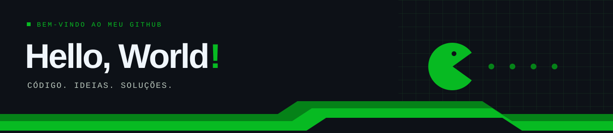
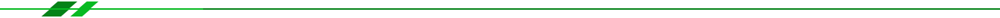
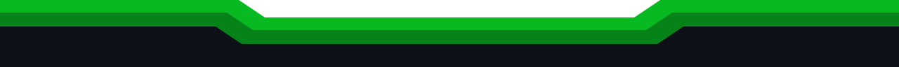

  

<h1 align="center">Gabriel Escramin</h1>

  <strong>Engenharia de Software</strong> &nbsp;·&nbsp; Desenvolvimento Front-end &nbsp;·&nbsp; Python

  
  

 

## 01 &nbsp;·&nbsp; Sobre mim

Sou **Gabriel Escramin**, estudante de **Engenharia de Software na Universidade de Brasília — UnB, campus Gama**. Minha trajetória combina desenvolvimento de interfaces web, programação em Python e C e aprendizado por meio de projetos acadêmicos.

Faço parte da equipe de front-end do **AgendaUnB**, uma plataforma de eventos e organização acadêmica. Também exploro programação orientada a objetos no **Mundo dos Dragões**, um RPG em Python. Entre interfaces, lógica e trabalho em equipe, sigo ampliando minha experiência na construção de software.

 

## 02 &nbsp;·&nbsp; Experiências e projetos

### AgendaUnB · Desenvolvimento Front-end

**Projeto em equipe · Métodos de Desenvolvimento de Software · UnB**

Atuação no front-end de uma plataforma que reúne eventos universitários e organização da rotina acadêmica.

- Participação no desenvolvimento do catálogo e da página de detalhes de eventos.
- Contribuição à visualização de calendário mensal e semanal.
- Colaboração em artefatos de produto e UX, com organização do trabalho em sprints.
- **Stack do front-end:** React, JavaScript, HTML, CSS, Vite e React Router.

[Ver repositório](https://github.com/unb-mds/2026-2-AgendaUnB) &nbsp;·&nbsp; [Documentação](https://unb-mds.github.io/2026-2-AgendaUnB/)

### Mundo dos Dragões · RPG em Python

**Projeto de programação orientada a objetos**

Jogo de RPG com personagens, combates e progressão, construído para explorar conceitos de orientação a objetos em Python.

- Modelagem de personagens e regras de jogo.
- Mecânicas de combate, rolagem de dados e interação com itens.
- **Tecnologia:** Python.

[Ver repositório](https://github.com/Bielziin07/Jogo-RPG-Mundo-dos-Drag-es-)

 

## 03 &nbsp;·&nbsp; Stack tecnológica

**Linguagens**

  
  
  

**Front-end**

  
  
  
  

**Ferramentas e design**

  
  
  
  

 

## 04 &nbsp;·&nbsp; Habilidades

- **Desenvolvimento de interfaces** — componentes React, organização visual e adaptação de telas a diferentes dispositivos.
- **Lógica e orientação a objetos** — modelagem de entidades, regras e interações em Python.
- **Prototipação e UX** — uso de Figma e participação na elaboração de artefatos de produto.
- **Colaboração em software** — versionamento com Git e GitHub, divisão de tarefas e acompanhamento por sprints.
- **Documentação técnica** — registro de decisões e aprendizados em projetos acadêmicos.

 

## 05 &nbsp;·&nbsp; Contributions

Um commit de cada vez.

<picture>
  <source media="(prefers-color-scheme: dark)" srcset="./dist/pacman-contribution-graph-dark.svg" />
  <source media="(prefers-color-scheme: light)" srcset="./dist/pacman-contribution-graph.svg" />
  
</picture>

 

<h2 align="center" id="contato">Vamos conversar?</h2>

  Para trocar ideias sobre desenvolvimento e conhecer meus projetos:

  
  

 

  

